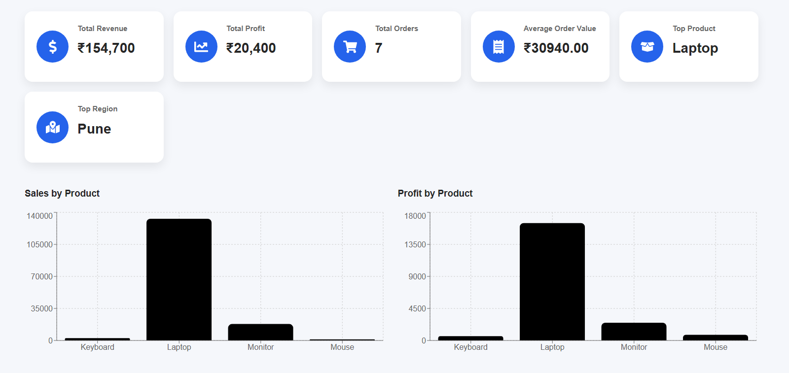

# 📊 InsightAI — AI-Powered Business Intelligence Platform

[](https://fastapi.tiangolo.com/)
[](https://react.dev/)
[](https://vitejs.dev/)
[](https://mui.com/)
[](https://ollama.com/)
[](LICENSE)

**InsightAI** is an enterprise-grade, full-stack Business Intelligence & Analytics platform. Upload raw business datasets in CSV or Excel format to automatically sanitize data, generate real-time multi-dimensional executive dashboards, detect statistical anomalies, evaluate SWOT matrices, and converse directly with an AI Business Analyst powered by **Google Gemma 4B** through local Ollama inference.

---

## 🌟 Core Highlights

- 📁 **Universal Dataset Ingestion**: Robust handling of CSV and Excel (`.csv`, `.xlsx`, `.tsv`) with multi-encoding recovery (`utf-8`, `utf-8-sig`, `latin1`, `cp1252`), custom delimiters, and automatic repair of title rows and duplicate headers.
- 💱 **Intelligent Data Sanitization**: Automatically strips currency symbols (`₹, $, €, £, ¥`), thousand-separator commas, percentages, and accounting parentheses, turning formatted text into numerical metrics.
- 🔄 **Dual Engine Intelligence**:
  - **Financial BI Mode**: Dynamic ranking of sales, net profit, profit margins, average order value (AOV), and Pareto (80/20) concentration while blacklisting false-positive technical ID/phone columns.
  - **Volume / Master Ledger Mode**: Gracefully handles non-numeric entity logs, calculating frequency distributions so dashboards never render blank.
- 💬 **AI Business Analyst Chatbot**: Context-grounded business advisor powered by **Google Gemma 4B** (`gemma3:4b` / `gemma4`) via local Ollama. Seamlessly switches models through an in-app selector modal and includes a deterministic analytical fallback engine.
- 📑 **Strategic Executive Briefing & SWOT**: Automated formulation of Strengths, Weaknesses, Opportunities, and Threats, ready for 1-click clipboard export or PDF printing.
- ⚠️ **Automated Anomaly & Outlier Auditing**: Instant flagging of loss-making products and order value spikes exceeding 3.5× normal transaction thresholds.
- 🧹 **1-Click Data Cleaning**: Automatic removal of duplicate rows, median/mode imputation of missing values, and export of cleaned CSVs.
- 📋 **Dataset Profiling**: Complete structural audit displaying row/column counts, memory footprint, missing value ratios, and column type breakdowns.

---

## 📸 Dashboard Showcase



---

## 🛠️ Architecture & Tech Stack

```
InsightAI Architecture
├── Frontend (React 19 + Vite 8 + Material UI v9 + Recharts)
│   ├── Interactive Tabbed Navigation (Overview, Deep Analytics, AI Analyst, SWOT, Data Health)
│   ├── Responsive Recharts (Time Series Area Chart, Category Donut, Product/Region Bars)
│   ├── AI Analyst Chat Interface with Quick Prompts & Ollama Model Selector
│   └── Dataset Live Preview & File Cleaning Downloader
│
└── Backend (FastAPI + Pandas + NumPy + Ollama SDK)
    ├── /dashboard    -> Data sanitization, column detection, metrics & SWOT synthesis
    ├── /ai/chat      -> Ground-truth context prompt engine routed to local Gemma 4B
    ├── /ai/status    -> Live Ollama status, active model, and installed model registry
    ├── /ai/model     -> Runtime AI model configuration
    ├── /clean        -> Automated data cleaning & export
    └── /analyze      -> Instant structural dataset profiler
```

### Stack Breakdown

| Layer | Technologies |
| :--- | :--- |
| **Frontend** | React 19, Vite 8, Material UI (MUI) 9, Recharts 3, Axios, React Icons |
| **Backend** | FastAPI, Python 3.12+, Uvicorn, Pandas, NumPy, OpenPyXL |
| **AI / LLM** | Ollama, Google Gemma 4B (`gemma3:4b`), Meta Llama 3, Phi-3 |
| **Data Formats** | CSV, TSV, XLSX, XLS |

---

## 📂 Project Directory Structure

```
InsightAI/
├── app/
│   ├── ai/
│   │   ├── analyzer.py        # Executive report generator & prompt formatter
│   │   ├── chatbot.py         # Conversational business analyst engine
│   │   ├── llm.py             # Ollama dynamic model connector & fallback logic
│   │   └── prompts.py         # Structured executive analysis prompts
│   ├── services/
│   │   ├── dashboard_service.py # Financial & volume BI metrics, SWOT, Pareto & anomaly detection
│   │   ├── data_cleaner.py    # Auto-cleaning pipeline (deduplication & imputation)
│   │   └── data_profiler.py   # Statistical profiling & column typing
│   ├── utils/
│   │   └── file_manager.py    # Safe multi-encoding file loader & currency sanitizer
│   └── main.py                # FastAPI REST endpoints & CORS configuration
├── frontend/
│   ├── src/
│   │   ├── components/
│   │   │   ├── dashboard/     # KPICards, Charts, DeepAnalytics, AIChatbot, ExecutiveReport
│   │   │   ├── layout/        # Navbar
│   │   │   └── upload/        # Drag-and-drop file upload & live preview
│   │   ├── pages/             # Dashboard main page
│   │   ├── services/          # Axios API client
│   │   └── theme/             # Custom enterprise MUI theme
│   ├── package.json
│   └── vite.config.js
├── datasets/                  # Sample test spreadsheets and sales CSVs
├── screenshots/               # Dashboard preview images
├── scripts/                   # Auxiliary startup scripts
├── start.bat                  # 1-Click launcher (checks Ollama, frees ports, starts both servers)
├── requirements.txt           # Python backend dependencies
└── README.md
```

---

## ⚡ Quick Start

### 1. One-Click Launcher (Windows)

Simply double-click **`start.bat`** in the root directory. It automatically:
1. Verifies the local Ollama service.
2. Clears any stale port conflicts on ports `8000` and `5173`.
3. Activates the virtual environment and launches FastAPI on port `8000`.
4. Starts the Vite development server on port `5173`.

---

### 2. Manual Setup

#### Backend Setup

```bash
# Clone the repository
git clone https://github.com/pewekarvedang/InsightAI.git
cd InsightAI

# Create and activate Python virtual environment
py -3 -m venv venv
.\venv\Scripts\activate      # Windows
# source venv/bin/activate    # Linux / macOS

# Install dependencies
pip install -r requirements.txt

# Start FastAPI server
uvicorn app.main:app --reload --port 8000
```
- API is live at: `http://127.0.0.1:8000`
- Interactive Swagger docs at: `http://127.0.0.1:8000/docs`

#### Frontend Setup

```bash
# From the project root
cd frontend

# Install dependencies
npm install

# Start Vite development server
npm run dev
```
- Web Dashboard is live at: `http://localhost:5173`

---

## 🤖 Configuring Local AI (Ollama & Gemma 4B)

InsightAI is pre-configured to use **Google Gemma 4B** (`gemma3:4b`) via Ollama.

1. **Install Ollama**: Download from [ollama.com](https://ollama.com).
2. **Pull the Gemma 4B Model**:
   ```bash
   ollama run gemma3:4b
   ```
3. **Model Selection in UI**:
   - In the Dashboard, open the **AI Business Analyst** tab.
   - Click the **Ollama Model Chip** in the chatbot header to switch models (e.g. `gemma3:4b`, `gemma4`, `llama3`) or pull new weights in the background.
   - If Ollama is offline, InsightAI's built-in **Deterministic Analytical Engine** automatically handles all queries without interruptions.

---

## 📡 API Reference

| Method | Endpoint | Description |
| :--- | :--- | :--- |
| `GET` | `/health` | Server health check |
| `POST` | `/dashboard` | Ingest CSV/Excel, sanitize data, generate metrics, preview & SWOT |
| `POST` | `/analyze` | Profile dataset columns, null counts, and structural schema |
| `POST` | `/clean` | Execute auto-cleaning pipeline and generate downloadable CSV |
| `GET` | `/download/{file}` | Download cleaned dataset |
| `POST` | `/ai/chat` | Query the AI Analyst with dataset context and conversation history |
| `GET` | `/ai/status` | Check local Ollama connection, active model, and installed models |
| `POST` | `/ai/model` | Change active Ollama model at runtime |
| `POST` | `/ai/pull` | Trigger background model download via Ollama |

---

## 👨‍💻 Author

**Vedang Pewekar**  
B.Tech — Computer Science & Business Systems (CSBS)  
GitHub: [@pewekarvedang](https://github.com/pewekarvedang)

---

## 📄 License

This project is licensed under the MIT License — see the [LICENSE](LICENSE) file for details.
